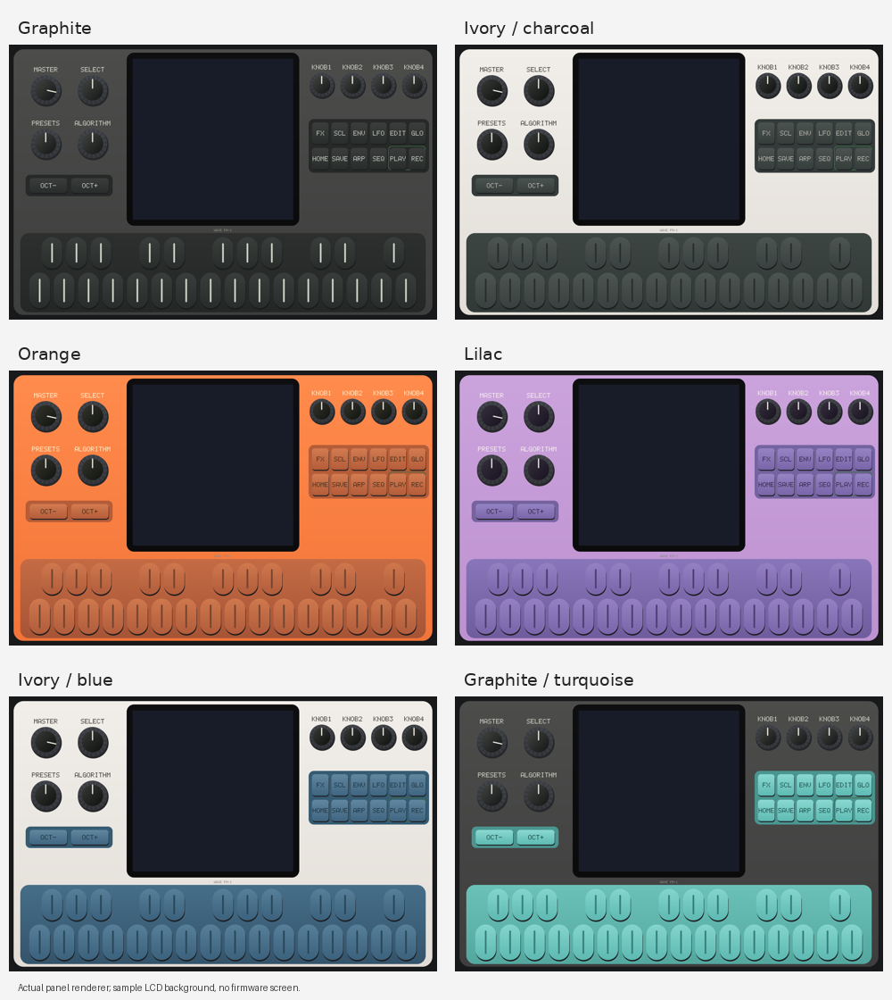

# Wave FM-1 Preview

Plugin **VST3 de 64 bits** que emula el M-VAVE FM-1 y permite cargar firmwares
`.fwsc`. Se basa en [fm1-emu de Joakim Eriksson](https://github.com/joakimeriksson/fm1-emu):
el motor, el panel interactivo y la pantalla del firmware proceden de ese proyecto.
Los créditos y licencias originales se conservan. La cuenta que mantiene este
repositorio no se presenta como autora de ese trabajo; consulta
[autoría y procedencia](AUTHORS.md).

## Descargar e instalar

- [Instalador Windows 0.2.2](https://github.com/jguillenconesa-coder/Wave-FM-1-plugin/releases/download/v0.2.2-preview.1/Wave-FM-1-0.2.2-Windows-x64-Setup.exe)
- [ZIP portátil Windows](https://github.com/jguillenconesa-coder/Wave-FM-1-plugin/releases/download/v0.2.2-preview.1/Wave-FM-1-0.2.2-Windows-x64-Portable.zip)
- [macOS Universal: instalador PKG](https://github.com/jguillenconesa-coder/Wave-FM-1-plugin/releases/download/v0.2.2-preview.1/Wave-FM-1-0.2.2-macOS-Universal.pkg)
- [macOS Universal: ZIP por usuario](https://github.com/jguillenconesa-coder/Wave-FM-1-plugin/releases/download/v0.2.2-preview.1/Wave-FM-1-0.2.2-macOS-Universal.zip)
- [Versión publicada, hashes y todos los archivos](https://github.com/jguillenconesa-coder/Wave-FM-1-plugin/releases/tag/v0.2.2-preview.1)
- [Instalar/desinstalar en Windows](docs/WINDOWS.md) · [macOS Intel y Apple Silicon](docs/MACOS.md)

Si la descarga directa falla, abre la página de la versión y selecciona el
archivo en **Assets**. Los paquetes macOS solo se publican si su compilación y
validación nativa terminan correctamente; su ausencia indica que siguen pendientes.

Windows instala por defecto en
`C:\Program Files\Common Files\VST3\Wave FM-1.vst3`, requiere permisos de
administrador y se elimina desde **Agregar o quitar programas**. La instalación
no cambia archivos de Live, sus preferencias ni proyectos. Al estar en la ruta
VST3 estándar, Live puede descubrirlo automáticamente en su siguiente escaneo.
Si tienes instalada la preview 0.1.0, desinstálala antes para evitar duplicados;
conserva tus proyectos y archivos exportados.

**Preview experimental.** El usuario ha confirmado que la versión anterior
funciona en su Live Windows. Esto no valida todas las configuraciones ni todos
los firmwares. Prueba la actualización en un Set vacío con tus proyectos
importantes cerrados y respaldados; no se garantiza riesgo cero.

## Firmwares y aspecto

**MIDI / Live** muestra etiquetas de alto contraste y una columna con Master,
los siete encoders y 14 botones asignables. Incluye instrucciones de Configure
y MIDI Map; los nombres coinciden con los parámetros de Live. Consulta
[cómo mapear tu controlador y qué representan los valores](docs/MIDI_LIVE.md).

**Community firmwares…** permite buscar entre 83 referencias conocidas,
consultar novedades en Firmware Hub y guardar un `.fwsc` sin actualizar un Set
automáticamente. Incluye enlaces alternativos a **64 publicaciones originales
de GitHub**, con hash de referencia. Los paquetes externos no forman parte
del instalador ni equivalen a firmwares completamente verificados. Consulta
[el explorador, las descargas y sus límites](docs/COMMUNITY_BROWSER.md).

En **0.2.2**, el botón **Download .fwsc…** utiliza preferentemente la publicación
original del autor y muestra la ruta guardada o el error. Corrige la descarga de
Melodee, bloqueada en el enlace del Hub. **Download in browser** permite guardar
manualmente desde el navegador; después se puede abrir el archivo en el plugin.

El menú **Firmware…** incluye **23 firmwares sin conexión**, con versiones
fijadas y pruebas reales de arranque, pantalla y audio. Entre ellos: Felucca,
X0X, AMB-1, FoMni-1, Polly, Skiff, DUB-1, Chipbox, Frodhes y Niagara Drift.
Consulta [la lista completa, autores, licencias y fuentes](firmware/README.md)
y [los candidatos pendientes o excluidos](firmware/RESEARCH.md).
Cada paquete se comprueba por tamaño y SHA-256 antes de cargarlo.

El menú conserva **Open firmware / save file…** y el botón **Load firmware /
save…** para `.fwsc` y `.fm1save` propios. Cambiar de firmware reinicia solo esa
instancia y sus patches; exporta primero para conservarlos. Cada instancia
mantiene motor, firmware, flash y skin independientes. Guarda los cambios desde
el firmware antes de guardar el Set: se conserva firmware y flash, no toda la RAM.

**Skin** ofrece los seis acabados de la imagen de referencia: **Graphite**,
**Ivory / charcoal**, **Orange**, **Lilac**, **Ivory / blue** y
**Graphite / turquoise**. Son paletas dibujadas a partir de esa referencia;
no se incluye la fotografía ni se afirma una equivalencia colorimétrica exacta.
Cambian carcasa, teclas y controles; pantalla y LED conservan sus colores.
La selección se guarda con cada instancia del proyecto.



Vista del panel original de fm1-emu (Joakim Eriksson, MIT) con las paletas de
esta integración. La pantalla de muestra es uniforme; al cargar un firmware
mostrará su interfaz. No se ha utilizado la fotografía del fabricante.

El instrumento sigue apareciendo como **FM-1**, fabricante **fm1-emu**, con
la identidad VST3 de la preview para recuperar proyectos anteriores.
No se garantiza un número ilimitado de instancias; el consumo de CPU varía.

## Desarrollo y compilación

Requisitos Windows: Git, Python 3, PowerShell 7, Rust 1.99.1, CMake >=3.27,
Visual Studio 2022 C++/Windows SDK e Inno Setup 7.1.0.

```powershell
./tools/build-windows.ps1
./tools/package-windows.ps1
```

También hay una compilación cruzada Linux/MinGW-w64 POSIX en
`tools/build-windows-cross.sh`. `cmake/windows-mingw.cmake` configura Windows
x64. El emulador se descarga en `.deps/fm1-emu` con revisión fija, sin modificar
sus fuentes. El wrapper recibe un parche local verificado por hash para cargar
únicamente su módulo CLAP privado. El bundle VST3 incluye ambos binarios y las
bibliotecas de ejecución se enlazan estáticamente.

Las pruebas de integridad propias se ejecutan con:

```sh
python3 -m unittest discover -s tests -v
```

El fork de interfaz está en `desktop/`; `tools/prepare-desktop.py` verifica la
base y genera un árbol separado sin modificar el emulador fijado. Para macOS:
`bash tools/build-macos.sh` y `bash tools/package-macos.sh` desde un Mac.

La preparación del motor en la nube sigue en `tools/setup-cloud.sh`. Usa el
checkout existente; no crees worktrees salvo petición explícita. GitHub Actions
repite las auditorías y prepara builds; un fallo de CI no convierte las pruebas
locales en una validación nativa. Los tags `v*-preview.*` publican los assets
verificados como prerelease, sin considerarlos versiones estables.

## Créditos, seguridad y limitaciones

- [Créditos y licencias de terceros](THIRD_PARTY_NOTICES.md)
- [Política de seguridad](SECURITY.md) e [informe de revisión](docs/SECURITY_REVIEW.md)
- [Contribuciones](CONTRIBUTING.md)

Este proyecto no está afiliado a M-VAVE ni a Ableton. Solo abre firmwares,
proyectos y estados de fuentes de confianza: el emulador se ejecuta dentro del
DAW y **no es un sandbox**. La preview no tiene firma Authenticode propia.
Consulta las comprobaciones y limitaciones; no desactives protecciones del sistema.
